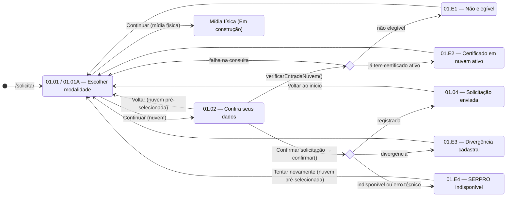

# Jornada de solicitação de certificado em nuvem

Mapa das telas e de quem decide cada transição. Os códigos são os frames do Figma
(**AR CAIXA → Fluxo V1 (em andamento) 2 → seção 01**).

> O guard roda **antes** de abrir 01.02; o diagrama o mostra saindo de 01.02 só para simplificar.

## Onde está cada decisão

| Decisão | Código |
|---|---|
| Quais modalidades aparecem na etapa 1 | `ElegibilidadeService` (`domain/certificado/`), carregado no bootstrap por `provideSessaoInicial()` |
| Entrar ou não na etapa 2 (01.E1 / 01.E2) | `SolicitacaoNuvemJornada.verificarEntradaNuvem()`, aplicado por `jornadaNuvemGuard` |
| Próxima tela depois do envio (01.04 / 01.E3 / 01.E4) | `SolicitacaoNuvemJornada.confirmar()` |
| Só abrir 01.04 com solicitação registrada | `solicitacaoRegistradaGuard` |
| Conteúdo de cada interrupção (textos, etapa, botão) | `pages/interrupcao/interrupcoes.ts` |
| Caminhos e etapas do [dsc] Progress | `solicitacao-certificado.paths.ts`, `solicitacao-certificado.etapas.ts` |

## Rotas

| URL | Tela |
|---|---|
| `/solicitar` | 01.01 / 01.01A (`?modalidade=nuvem` pré-seleciona a nuvem) |
| `/solicitar/nuvem/dados` | 01.02 |
| `/solicitar/nuvem/enviada` | 01.04 |
| `/solicitar/nuvem/interrompida/:motivo` | 01.E1–01.E4 (`nao-elegivel`, `certificado-ativo`, `divergencia-cadastral`, `serpro-indisponivel`) |
| `/solicitar/midia-fisica` | Em construção (seção 02) |

Para ver cada caminho no navegador, use os cenários simulados do README (`?cenario=`).
