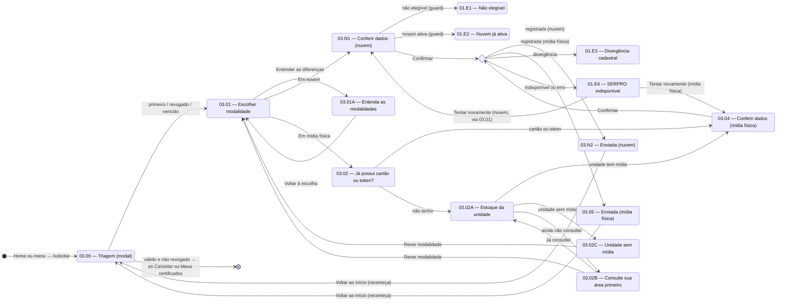

# Jornada de solicitação de certificado

Mapa das telas e de quem decide cada transição. Os códigos são os frames do Figma
(**AR CAIXA → Fluxo V1 (em andamento) → seção 03 — Solicitação guiada de certificado**).
As interrupções 01.E1–01.E4 vêm do fluxo anterior e foram **mantidas por decisão de produto**.

> "Solicitar primeira mídia" (03.02C) leva a Nova mídia física, ainda "Em construção". "Meus pedidos" (03.N2/03.05)
> leva a Acompanhar solicitações.

## Onde está cada decisão

| Decisão | Código |
|---|---|
| Reiniciar a jornada ao entrar (a triagem reaparece) | `iniciarJornadaResolver` (`guards/jornada.guards.ts`), ADR-14 |
| A triagem permite seguir? | `situacaoPermiteSolicitar()` / `responderTriagem()` (`state/solicitacao-certificado.jornada.ts`) |
| Quais modalidades aparecem em 03.01 | `ElegibilidadeService` (`domain/certificado/`), carregado no bootstrap |
| Próxima tela depois de cada resposta | `escolherModalidade()`, `informarMidiaExistente()`, `informarEstoqueUnidade()` |
| Entrar na conferência em nuvem (01.E1 / 01.E2) | `verificarEntradaNuvem()`, aplicado por `jornadaNuvemGuard` |
| Entrar na conferência de mídia física | `podeConferirMidiaFisica()`, aplicado por `midiaFisicaDefinidaGuard` |
| Próxima tela depois do envio | `confirmar()` |
| Textos das perguntas e orientações | `pages/pergunta/perguntas.ts`, `pages/orientacao/orientacoes.ts` |
| Textos das interrupções | `pages/interrupcao/interrupcoes.ts` |
| Caminhos | `solicitacao-certificado.paths.ts` |

## Rotas

| URL | Tela |
|---|---|
| `/solicitar` | 03.00 (modal) + 03.01 (`?modalidade=nuvem` pré-seleciona a nuvem) |
| `/solicitar/modalidades` | 03.01A |
| `/solicitar/nuvem/dados` · `/solicitar/nuvem/enviada` | 03.N1 · 03.N2 |
| `/solicitar/midia-fisica` | 03.02 |
| `/solicitar/midia-fisica/estoque` | 03.02A |
| `/solicitar/midia-fisica/aguardar-unidade` | 03.02B |
| `/solicitar/midia-fisica/sem-midia` | 03.02C |
| `/solicitar/midia-fisica/dados` · `/solicitar/midia-fisica/enviada` | 03.04 · 03.05 |
| `/solicitar/interrompida/:motivo` | 01.E1–01.E4 (`nao-elegivel`, `certificado-ativo`, `divergencia-cadastral`, `serpro-indisponivel`) |

Para ver cada caminho no navegador, use os cenários simulados do README (`?cenario=`).
